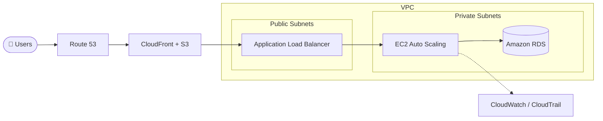

<!-- ===================== HEADER ===================== -->
<div align="center">


<a href="https://git.io/typing-svg">
  
</a>

<br/>


</div>

---

## 👨‍💻 About Me

```yaml
name:       Lokesh Narendra Baviskar
role:       Junior System Engineer – Application Support (L1.5) @ Cognizant
cert:       AWS Certified Solutions Architect – Associate (SAA-C03)
education:  MCA (2024–2026) · BCA (CGPA 9.34/10)
focus:      Cloud Support · Cloud Operations · Cloud Infrastructure
open_to:    Cloud Support / CloudOps / Infra roles
```

- ☁️ I turn production issues into **resolved tickets within SLA**, from logging to root-cause documentation
- 🏗️ I design **highly available, fault-tolerant** architectures on AWS using the Well-Architected Framework
- 🔎 I use **SQL + Linux** to dig into root causes, not just symptoms
- 🔐 I follow **least-privilege** principles for access and IAM
- 🌱 Currently deepening: **Linux administration · Python/Bash automation · AWS networking**

---

## 🛠️ Tech Stack

<div align="center">

**☁️ AWS**


**🐧 Systems, Scripting & Support**


**🌐 Web**


</div>

**Core concepts:** High Availability · Fault Tolerance · Disaster Recovery · Well-Architected Framework · TCP/IP · DNS · CIDR · NAT Gateway · VPN fundamentals · Incident & Service Request Management · Root Cause Analysis · Escalation Handling

---

## 🚀 Featured Projects

### 🏗️ Highly Available 3-Tier Web Application on AWS
A scalable, fault-tolerant architecture built across multiple Availability Zones.



`VPC` `ALB` `EC2 Auto Scaling` `RDS` `IAM` `S3` `CloudFront` `Route 53` `CloudWatch` `CloudTrail`

---

### ⚡ Serverless Application Architecture on AWS
An event-driven, cost-efficient backend: **API Gateway → Lambda → DynamoDB**, secured with IAM and monitored with CloudWatch.

`API Gateway` `Lambda` `DynamoDB` `IAM` `CloudWatch`

---

### 🚑 VitaRide – Ambulance Booking System
A web app with Profile, Ambulance, Booking and Payment modules. Rule-based logic assigns the **nearest available ambulance** by distance and availability.
🏆 **Copyright registered** with the Copyright Office, Government of India (Oct 2025).

`HTML` `CSS` `JavaScript`

---

### 📂 More on my GitHub

| Repository | What it is |
| ---------- | ---------- |
| [🌐 LokeshBaviskar](https://github.com/22karlokesh/LokeshBaviskar) | My personal portfolio website |
| [📄 cv](https://github.com/22karlokesh/cv) | HTML resume |
| [🧺 Laundry-Basket](https://github.com/22karlokesh/Laundry-Basket) | Online laundry service: place orders, track them and pay |
| [🎞️ parallaxScrolling](https://github.com/22karlokesh/parallaxScrolling) | Parallax scrolling effect with HTML & CSS |

---

## 💼 Experience

| Role | Company | Period |
| ---- | ------- | ------ |
| **Junior System Engineer – Application Support (L1.5)** | Cognizant Technology Solutions | Mar 2026 – Present |
| Warehouse Operations Executive (Intern) | AAJ Supply Chain Management Pvt. Ltd. | Feb 2026 – Mar 2026 |

**What I do day to day**
- Resolve production incidents and service requests **within SLA** in ServiceNow
- Troubleshoot application and user-access issues with cross-functional teams
- Provision and validate access using **least-privilege** principles
- Query production data with **SQL** to support investigations
- Maintain SOPs and keep stakeholders informed on incident status

---

## 🏅 Certifications & Achievements

- 🥇 **AWS Certified Solutions Architect – Associate (SAA-C03)**, Amazon Web Services (Sep 2026)
- 🐧 **Linux Training**, Spoken Tutorial / EduPyramids / SINE, IIT Bombay (Sep 2025)
- 📜 **Copyright Registration** for VitaRide, Government of India (Oct 2025)

---

## 📊 GitHub Stats

<div align="center">


</div>

---

## 📫 Let's Connect

<div align="center">

[](https://linkedin.com/in/baviskarlokesh)
[](mailto:baviskarlokesh2003@gmail.com)
[](https://github.com/22karlokesh/LokeshBaviskar)

<br/>

*"The cloud is just someone else's computer, but a well-architected one."* ☁️


</div>
